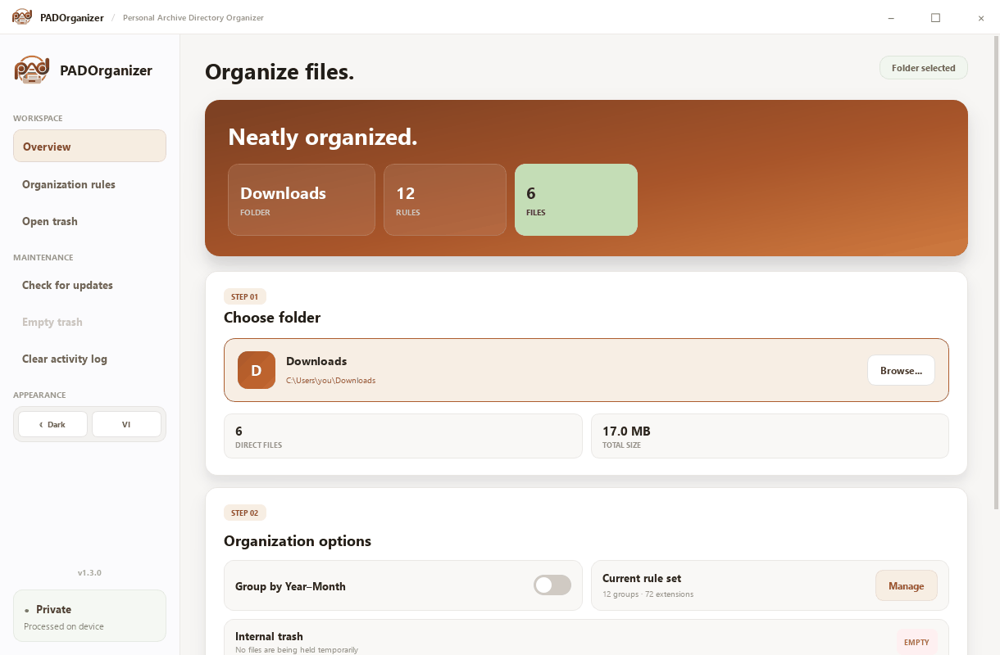

<div align="center">


**Organize folders, find duplicates and clean up safely — right on your computer.**

[](https://github.com/padduwcs/PADOrganizer/releases/latest)
[](https://github.com/padduwcs/PADOrganizer/releases)
[](https://github.com/padduwcs/PADOrganizer/actions/workflows/ci.yml)
[](#download-and-install)
[](LICENSE)

[Tiếng Việt](README.md) · **English**

[**⬇ Download PADOrganizer**](https://github.com/padduwcs/PADOrganizer/releases/latest)

</div>

<picture>
  <source media="(prefers-color-scheme: dark)" srcset="docs/images/screenshot-en-dark.png">
  
</picture>

## Features

| | |
|---|---|
| 🗂️ **Automatic sorting** | Moves files into `Images`, `Documents`, `Videos`, `Audio`… by extension. Group names and extensions are fully customizable. |
| 📅 **Year–Month folders** | Optionally files each item into `2026-10`-style subfolders by modification date for long-term archives. |
| 🔍 **Duplicate finder** | Compares real file contents, not names, and lets you pick which copy to keep in each group. |
| ↩️ **Undo** | Puts files back after the latest organize or cleanup run in the current session. |
| 🗑️ **Internal trash** | Removed files wait in a safe holding folder until you delete them for good. |
| 🛡️ **Safe by default** | Never touches hidden files, system files, subfolders or operating-system folders. |
| 🔒 **Private** | Everything runs locally. The app contacts GitHub only when you click **Check for updates**. |
| 🌗 **Light/Dark · VI/EN** | Switch theme and language instantly. |

## Download and install

Grab the package for your system from the [**Releases**](https://github.com/padduwcs/PADOrganizer/releases/latest) page. No Python or extra libraries required.

| System | Package | Notes |
|---|---|---|
| Windows 10/11 | `PADOrganizer-Setup-vX.Y.Z.exe` | Recommended. Per-user install, no administrator rights, in-app updates. |
| Windows 10/11 | `PADOrganizer-portable-vX.Y.Z.exe` | No installation. Put it in its own folder before running. |
| Ubuntu 22.04+, Debian 12+ | `padorganizer_X.Y.Z_amd64.deb` | Integrates with the application menu. |
| Other Linux (x86_64) | `PADOrganizer-vX.Y.Z-x86_64.AppImage` | Runs directly, nothing to install. |

### Windows

1. Download `PADOrganizer-Setup-vX.Y.Z.exe` and open it.
2. Follow the setup wizard.
3. Launch PADOrganizer from the Start menu or the desktop shortcut.

> [!NOTE]
> Windows SmartScreen may warn you because the app is not code-signed yet. Continue only if the file came from this official repository. You can compare its SHA-256 hash with `SHA256SUMS.txt` from the same release:
>
> ```powershell
> Get-FileHash .\PADOrganizer-Setup-vX.Y.Z.exe -Algorithm SHA256
> ```

### Ubuntu / Debian

Open the `.deb` file with your software installer and choose **Install**, or run this in the download folder:

```bash
sudo apt install ./padorganizer_X.Y.Z_amd64.deb
```

Uninstall with `sudo apt remove padorganizer`.

### AppImage

Mark the file as executable (**Properties → Permissions**) and double-click it, or:

```bash
chmod +x PADOrganizer-vX.Y.Z-x86_64.AppImage
./PADOrganizer-vX.Y.Z-x86_64.AppImage
```

If your system has no FUSE, add `--appimage-extract-and-run`.

## Getting started

1. Drag a folder into the window or choose **Browse...**
2. Turn on **Group by Year–Month** or open **Organization rules** to customize.
3. Click **Organize now** and watch the progress.
4. Not happy? Click **Undo** to put everything back.

To clean up duplicates, click **Find duplicates**. PADOrganizer groups files with identical contents and preselects the copy with the shortest name to keep. Change the choice or skip any group, then move the rest to the internal trash. Double-check before choosing **Delete permanently**.

### What does PADOrganizer touch?

- Only files **directly** inside the selected folder. Subfolders and their contents stay where they are.
- Hidden files, system files (such as `.bashrc` or `desktop.ini`) and symbolic links are always skipped.
- Drive roots, your home folder and system folders such as `C:\Windows`, `Program Files` or `/usr` cannot be selected. Pick a specific subfolder such as `Downloads` or `Desktop`.
- Name clashes at the destination are renamed to `name_1.ext`; nothing is ever overwritten.
- Empty (0-byte) files are never reported as duplicates.

### Keyboard shortcuts

| Keys | Action |
|---|---|
| `Ctrl+O` | Choose folder |
| `Ctrl+Enter` | Organize folder |
| `Ctrl+D` | Find duplicates |
| `Ctrl+Z` | Undo |
| `Ctrl+,` | Open organization rules |

## Updates

Click **Check for updates** in the **Maintenance** section. PADOrganizer never checks in the background.

- **Windows installer build:** the app downloads the installer, verifies its SHA-256 hash and asks again before installing.
- **Windows portable, Linux or source builds:** the app opens the Releases page so you can pick the right package. On Linux, install the new `.deb` over the old one or replace the AppImage.

Updates always keep your rules, activity log and internal trash. See what changed in the [CHANGELOG](CHANGELOG.md) (Vietnamese).

## Data and privacy

PADOrganizer collects and sends no data. Everything stays on your device:

| Item | Windows | Linux |
|---|---|---|
| Settings | `config.json` next to the program | `~/.config/PADOrganizer/config.json` |
| Activity log | `logs\` next to the program | `~/.local/state/PADOrganizer/logs/` |
| Internal trash | `PADOrganizer_Trash\` next to the program | `~/.local/share/PADOrganizer/PADOrganizer_Trash/` |

The Windows installer places the program in `%LOCALAPPDATA%\Programs\PADOrganizer`. On Linux, `XDG_CONFIG_HOME`, `XDG_STATE_HOME` and `XDG_DATA_HOME` are respected when set.

Uninstalling does not delete your personal data. To remove everything, delete the folders above after uninstalling.

## FAQ

<details>
<summary><b>How long can I undo?</b></summary>

Undo history lives in the current session. You can step back through each organize or cleanup run until you close the app. Files moved to the internal trash can still be recovered by hand via **Open trash**.
</details>

<details>
<summary><b>Why can't I pick my home folder or <code>C:\</code>?</b></summary>

Those folders hold configuration files for the operating system and other apps. Moving them could break things, so PADOrganizer blocks them up front. Choose a specific subfolder instead.
</details>

<details>
<summary><b>Where do files without a matching rule go?</b></summary>

Into the `Others` group. Add their extensions to a suitable group in **Organization rules**.
</details>

<details>
<summary><b>Does the internal trash empty itself?</b></summary>

No. Files keep using disk space until you choose **Empty trash** under **Maintenance**.
</details>

## Contributing

Bug reports, ideas, translations and code are all welcome.

- Found a bug or have an idea? [Open an issue](https://github.com/padduwcs/PADOrganizer/issues/new/choose).
- Want to send code? Read [CONTRIBUTING.md](CONTRIBUTING.md) and the [development guide](docs/DEVELOPMENT.md) (Vietnamese).
- Found a security issue? Report it privately as described in [SECURITY.md](SECURITY.md).

## License

PADOrganizer is released under the [Apache License 2.0](LICENSE). See [NOTICE](NOTICE) for copyright and third-party information.

<div align="center">
<sub>© 2026 <a href="https://github.com/padduwcs">padduwcs</a> · Apache-2.0</sub>
</div>
