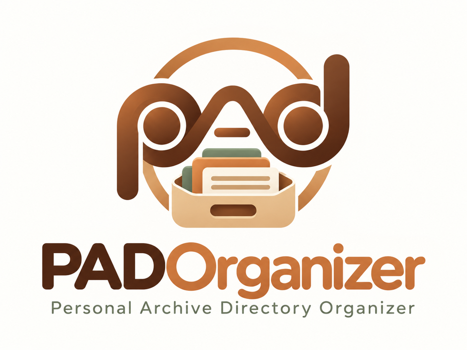
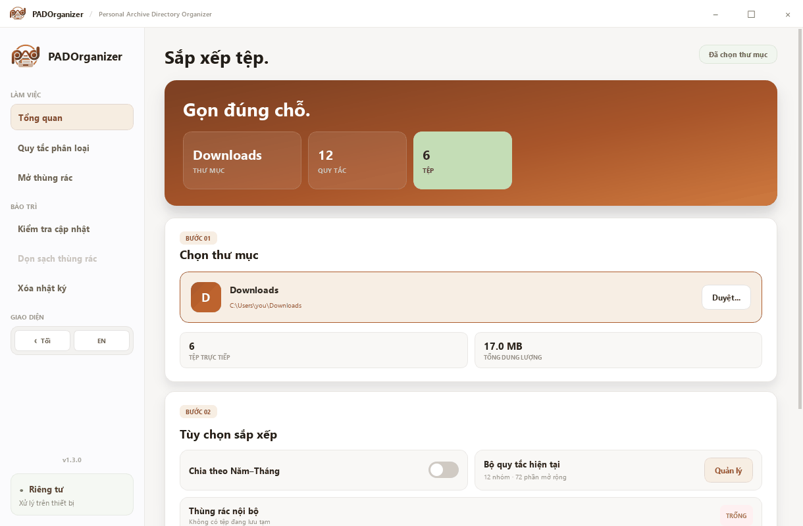

<div align="center">



**Sắp xếp thư mục, tìm tệp trùng và dọn dẹp an toàn — ngay trên máy tính của bạn.**

[](https://github.com/padduwcs/PADOrganizer/releases/latest)
[](https://github.com/padduwcs/PADOrganizer/releases)
[](https://github.com/padduwcs/PADOrganizer/actions/workflows/ci.yml)
[](#tải-và-cài-đặt)
[](LICENSE)

**Tiếng Việt** · [English](README.en.md)

[**⬇ Tải PADOrganizer**](https://github.com/padduwcs/PADOrganizer/releases/latest)

</div>

<picture>
  <source media="(prefers-color-scheme: dark)" srcset="docs/images/screenshot-vi-dark.png">
  
</picture>

## Tính năng

| | |
|---|---|
| 🗂️ **Phân loại tự động** | Đưa tệp vào `Images`, `Documents`, `Videos`, `Audio`… theo phần mở rộng. Tên nhóm và phần mở rộng tùy chỉnh được. |
| 📅 **Chia theo Năm–Tháng** | Xếp tiếp vào thư mục con `2026-10` theo ngày sửa đổi, tiện lưu trữ lâu dài. |
| 🔍 **Tìm tệp trùng** | So sánh theo nội dung thật, không theo tên. Bạn chọn bản giữ lại cho từng nhóm. |
| ↩️ **Hoàn tác** | Đưa tệp về chỗ cũ sau lần sắp xếp hoặc dọn dẹp gần nhất trong phiên. |
| 🗑️ **Thùng rác nội bộ** | Tệp bị dọn được giữ lại để bạn kiểm tra trước khi xóa vĩnh viễn. |
| 🛡️ **An toàn mặc định** | Không đụng tới tệp ẩn, tệp hệ thống, thư mục con và thư mục hệ điều hành. |
| 🔒 **Riêng tư** | Mọi thao tác diễn ra trên máy. Chỉ kết nối GitHub khi bạn bấm **Kiểm tra cập nhật**. |
| 🌗 **Sáng/Tối · VI/EN** | Chuyển giao diện và ngôn ngữ tức thì. |

## Tải và cài đặt

Tải gói phù hợp tại trang [**Releases**](https://github.com/padduwcs/PADOrganizer/releases/latest). Không cần cài Python hay thư viện nào khác.

| Hệ điều hành | Gói | Ghi chú |
|---|---|---|
| Windows 10/11 | `PADOrganizer-Setup-vX.Y.Z.exe` | Khuyên dùng. Cài cho người dùng hiện tại, không cần quyền Administrator, hỗ trợ cập nhật trong ứng dụng. |
| Windows 10/11 | `PADOrganizer-portable-vX.Y.Z.exe` | Không cần cài. Đặt trong một thư mục riêng trước khi chạy. |
| Ubuntu 22.04+, Debian 12+ | `padorganizer_X.Y.Z_amd64.deb` | Tích hợp menu ứng dụng. |
| Linux khác (x86_64) | `PADOrganizer-vX.Y.Z-x86_64.AppImage` | Chạy trực tiếp, không cần cài. |

### Windows

1. Tải `PADOrganizer-Setup-vX.Y.Z.exe` và mở tệp vừa tải.
2. Làm theo hướng dẫn cài đặt.
3. Khởi động PADOrganizer từ Start Menu hoặc shortcut ngoài Desktop.

> [!NOTE]
> Windows SmartScreen có thể cảnh báo vì ứng dụng chưa có chữ ký số. Chỉ tiếp tục khi tệp được tải từ repository chính thức này. Bạn có thể đối chiếu mã SHA-256 với `SHA256SUMS.txt` trong cùng bản phát hành:
>
> ```powershell
> Get-FileHash .\PADOrganizer-Setup-vX.Y.Z.exe -Algorithm SHA256
> ```

### Ubuntu / Debian

Mở tệp `.deb` bằng trình cài đặt phần mềm và chọn **Cài đặt**, hoặc chạy trong Terminal tại thư mục tải xuống:

```bash
sudo apt install ./padorganizer_X.Y.Z_amd64.deb
```

Gỡ cài đặt bằng `sudo apt remove padorganizer`.

### AppImage

Cho phép tệp được thực thi (**Thuộc tính → Quyền**) rồi nhấp đúp, hoặc:

```bash
chmod +x PADOrganizer-vX.Y.Z-x86_64.AppImage
./PADOrganizer-vX.Y.Z-x86_64.AppImage
```

Nếu hệ thống không có FUSE, thêm tham số `--appimage-extract-and-run`.

## Bắt đầu sử dụng

1. Kéo thả thư mục vào ứng dụng hoặc chọn **Duyệt...**
2. Bật **Chia theo Năm–Tháng** hoặc mở **Quy tắc phân loại** nếu muốn tùy chỉnh.
3. Chọn **Tổ chức ngay** và theo dõi tiến độ.
4. Không vừa ý? Chọn **Hoàn tác** để đưa mọi thứ về chỗ cũ.

Để dọn tệp trùng, chọn **Tìm bản trùng**. PADOrganizer gom các tệp có nội dung giống hệt nhau và chọn sẵn bản có tên ngắn gọn nhất để giữ lại. Bạn có thể đổi lựa chọn, bỏ qua từng nhóm, rồi chuyển các bản còn lại vào thùng rác nội bộ. Hãy kiểm tra kỹ trước khi chọn **Xóa vĩnh viễn**.

### PADOrganizer xử lý những gì?

- Chỉ các tệp nằm **trực tiếp** trong thư mục đã chọn. Thư mục con và nội dung bên trong được giữ nguyên.
- Luôn bỏ qua tệp ẩn, tệp hệ thống (ví dụ `.bashrc`, `desktop.ini`) và liên kết tượng trưng (symlink).
- Không cho chọn thư mục gốc của ổ đĩa, thư mục Home và thư mục hệ thống như `C:\Windows`, `Program Files` hoặc `/usr`. Hãy chọn một thư mục con như `Downloads` hay `Desktop`.
- Tệp có tên trùng ở nơi đến được đổi tên thành `ten_1.ext`, không bao giờ ghi đè.
- Tệp rỗng (0 byte) không được tính là bản trùng.

### Phím tắt

| Phím | Thao tác |
|---|---|
| `Ctrl+O` | Chọn thư mục |
| `Ctrl+Enter` | Tổ chức thư mục |
| `Ctrl+D` | Tìm tệp trùng |
| `Ctrl+Z` | Hoàn tác |
| `Ctrl+,` | Mở quy tắc phân loại |

## Cập nhật phiên bản

Chọn **Kiểm tra cập nhật** trong mục **Bảo trì**. PADOrganizer không bao giờ tự kiểm tra trong nền.

- **Bản cài đặt Windows:** ứng dụng tải Installer, xác minh SHA-256 và hỏi lại trước khi cài.
- **Windows portable, Linux hoặc chạy từ mã nguồn:** ứng dụng mở trang Release để bạn chọn gói phù hợp. Trên Linux, cài đè tệp `.deb` mới hoặc thay AppImage cũ.

Cập nhật luôn giữ nguyên quy tắc, nhật ký và thùng rác nội bộ. Xem những gì đã thay đổi trong [CHANGELOG](CHANGELOG.md).

## Dữ liệu và quyền riêng tư

PADOrganizer không thu thập hay gửi dữ liệu đi đâu. Mọi thứ được lưu trên thiết bị:

| Nội dung | Windows | Linux |
|---|---|---|
| Cấu hình | `config.json` cạnh tệp chương trình | `~/.config/PADOrganizer/config.json` |
| Nhật ký | `logs\` cạnh tệp chương trình | `~/.local/state/PADOrganizer/logs/` |
| Thùng rác nội bộ | `PADOrganizer_Trash\` cạnh tệp chương trình | `~/.local/share/PADOrganizer/PADOrganizer_Trash/` |

Bản cài đặt Windows đặt chương trình tại `%LOCALAPPDATA%\Programs\PADOrganizer`. Trên Linux, các biến `XDG_CONFIG_HOME`, `XDG_STATE_HOME` và `XDG_DATA_HOME` được tôn trọng nếu đã thiết lập.

Gỡ ứng dụng không tự xóa dữ liệu cá nhân. Nếu muốn dọn sạch hoàn toàn, hãy xóa các thư mục trên sau khi gỡ.

## Câu hỏi thường gặp

<details>
<summary><b>Hoàn tác được bao lâu?</b></summary>

Lịch sử hoàn tác lưu trong phiên đang mở. Bạn có thể hoàn tác lần lượt từng lần sắp xếp hoặc dọn dẹp cho tới khi đóng ứng dụng. Tệp đã chuyển vào thùng rác nội bộ vẫn có thể lấy lại thủ công qua **Mở thùng rác**.
</details>

<details>
<summary><b>Vì sao không chọn được thư mục Home hoặc ổ <code>C:\</code>?</b></summary>

Đây là các thư mục chứa tệp cấu hình của hệ điều hành và ứng dụng khác. Di chuyển nhầm có thể khiến chúng ngừng hoạt động, nên PADOrganizer chặn từ đầu. Hãy chọn một thư mục con cụ thể.
</details>

<details>
<summary><b>Tệp không khớp quy tắc nào sẽ đi đâu?</b></summary>

Vào nhóm `Others`. Bạn có thể thêm phần mở rộng vào nhóm phù hợp trong **Quy tắc phân loại**.
</details>

<details>
<summary><b>Thùng rác nội bộ có tự dọn không?</b></summary>

Không. Tệp vẫn chiếm dung lượng cho đến khi bạn chọn **Dọn sạch thùng rác** trong mục **Bảo trì**.
</details>

## Đóng góp

Mọi đóng góp đều được hoan nghênh: báo lỗi, đề xuất, bản dịch hay mã nguồn.

- Gặp lỗi hoặc có ý tưởng? [Tạo issue](https://github.com/padduwcs/PADOrganizer/issues/new/choose).
- Muốn gửi mã? Đọc [CONTRIBUTING.md](CONTRIBUTING.md) và [Hướng dẫn phát triển](docs/DEVELOPMENT.md).
- Phát hiện lỗ hổng bảo mật? Báo riêng theo [SECURITY.md](SECURITY.md).

## Giấy phép

PADOrganizer được phát hành theo [Giấy phép Apache 2.0](LICENSE). Xem [NOTICE](NOTICE) để biết thông tin bản quyền và các thành phần bên thứ ba.

<div align="center">
<sub>© 2026 <a href="https://github.com/padduwcs">padduwcs</a> · Apache-2.0</sub>
</div>
